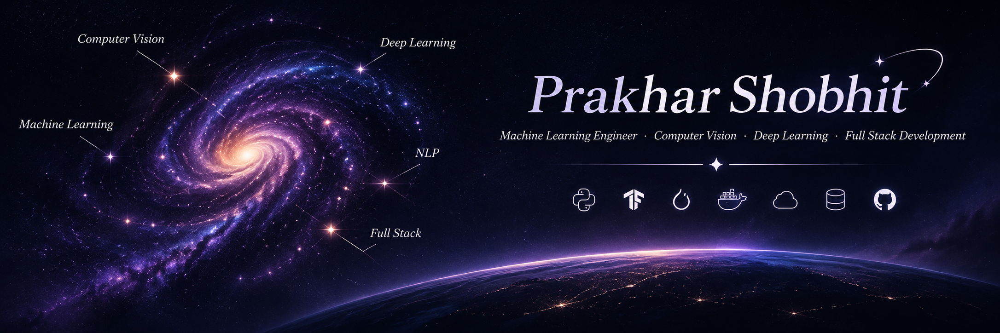
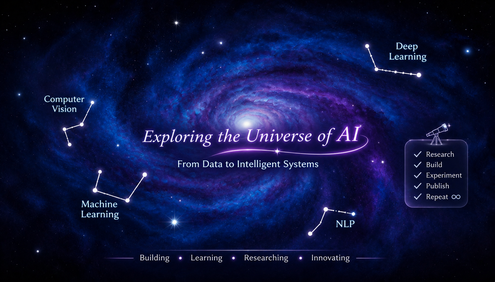

## About Me

I'm a Computer Science and Engineering graduate interested in building intelligent systems through Machine Learning, Deep Learning and Computer Vision. I also enjoy developing scalable backend services and full-stack applications.

My areas of interest include Vision Transformers, CNN architectures, medical image analysis, Natural Language Processing and applied machine learning.

## Technical Skills

| Area | Technologies |
|---|---|
| Programming | Python, C++, Java, SQL, JavaScript |
| Machine Learning | TensorFlow, Keras, Scikit-learn |
| Computer Vision | Vision Transformers (ViT), CNNs, OpenCV |
| NLP | NLTK, spaCy |
| Backend & APIs | .NET, Node.js, Flask, REST APIs |
| Databases | MySQL, MongoDB, SQLite |
| Cloud & Tools | Microsoft Azure, AWS, Git, Jupyter |

## Experience

- **Full Stack Developer Intern — GlobalLogic** (Oct 2024 – Mar 2025)
  - Developed .NET backend services and REST APIs.
  - Implemented JWT-based authentication and role-based access control.
  - Worked with Microsoft Azure and optimized SQL/database operations.

- **Machine Learning Research Intern — IIT (BHU), Varanasi** (Jun 2023 – Nov 2023)
  - Worked on Vision Transformer-based melanoma detection using dermoscopic images.
  - Contributed to research resulting in an IEEE publication.

## Featured Projects

- **Melanoma Detection using Vision Transformers** — ViT-based melanoma classification with attention mechanisms; reported 91% test accuracy.
- **Brain Tumor Detection using CNN (VGG16)** — MRI image classification with preprocessing and data augmentation; reported 92% accuracy.
- **Customer Churn Analysis — BCG (PowerCo)** — End-to-end data analysis and Random Forest modelling; reported 85% accuracy.
- **Sentiment Analysis of Market News** — NLP pipeline for sentiment classification of commodity-market news articles.

## Research & Publication

**Vision Transformer and Attention-Based Melanoma Disease Classification.**

## Achievement

- **GATE 2026 — Data Science and Artificial Intelligence:** Ranked in the top 14% among 70,000+ candidates, as stated in my resume.

## Connect

- **LinkedIn:** [Prakhar Shobhit](https://www.linkedin.com/in/Prakhar-Shobhit/)
- **Email:** [prakharshobhit1209@gmail.com](mailto:prakharshobhit1209@gmail.com)

---

*Always learning, experimenting, and building impactful technology.*
